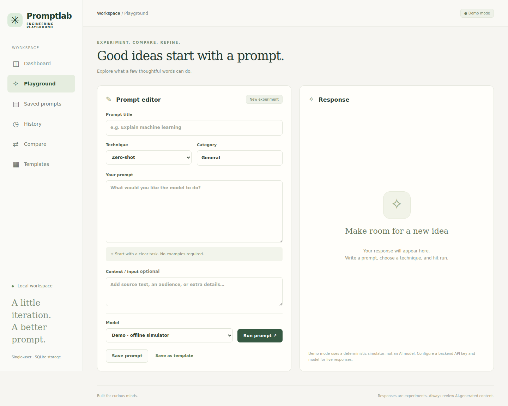

# Prompt Engineering Playground

A complete single-user workspace for creating, testing, comparing and evaluating LLM prompts. Built from [the project brief](Prompt_Engineering_Playground_Project.md) and [the full PDF guide](Prompt_Engineering_Playground_Full_Project.pdf).

**React + Vite · Python + FastAPI · SQLite**



The repository keeps its existing name and original resume-analysis scripts (`taPROJECT.py`, `ta2.py`, `taproject.pdf`). The new application lives in `backend/` and `frontend/`.

## Features

- Dashboard with saved prompt, experiment, evaluation and template counts.
- Prompt CRUD with title, category, task text and optional input/context.
- Five techniques: zero-shot, few-shot, role-based, structured output and step-by-step.
- Configurable server-side Chat Completions API adapter and model allowlist.
- An explicitly labelled offline simulator so the entire workflow runs without an API key. **Demo responses are deterministic placeholders, not AI inference.**
- Persisted runs with immutable prompt snapshots, final rendered prompt, model, timestamp and latency. Editing or deleting a prompt does not erase its previous runs.
- Searchable history, reuse, deletion and JSON export.
- Side-by-side comparison of any two runs with manual feedback, without an automatic winner.
- Relevance, clarity and completeness ratings (1–5) and notes.
- Template CRUD, category/content search, previews and five built-in starting points. Using a template creates an independent prompt.
- Responsive desktop and mobile UI, request validation, progress states and useful errors.

## Requirements

- Python 3.11+ (tested on 3.12).
- Node.js 20.19+ or 22.12+ and npm.
- Optional: a Chat Completions-compatible provider account, API key and supported model ID.

## Start from scratch

Clone this repository, then use two terminals. Commands below assume you are in the repository root.

### 1. Backend — Windows PowerShell

```powershell
cd backend
py -m venv .venv
.\.venv\Scripts\python.exe -m pip install -r requirements-dev.txt
Copy-Item .env.example .env
.\.venv\Scripts\python.exe -m uvicorn app.main:app --reload --host 127.0.0.1 --port 8000
```

No activation or PowerShell execution-policy changes are needed.

### Backend — macOS / Linux

```bash
cd backend
python3 -m venv .venv
.venv/bin/python -m pip install -r requirements-dev.txt
cp .env.example .env
.venv/bin/python -m uvicorn app.main:app --reload --host 127.0.0.1 --port 8000
```

API health: <http://127.0.0.1:8000/api/health>
Interactive API documentation: <http://127.0.0.1:8000/docs>

### 2. Frontend — new terminal

```bash
cd frontend
npm ci
npm run dev
```

Open **<http://127.0.0.1:5173>**. Vite forwards `/api` to FastAPI on port 8000. Start with the Demo model; it requires no credentials.

### 3. First complete experiment

1. In Playground enter a title, a prompt and a technique. Add context if needed.
2. Click **Run prompt**. The prompt and response are saved automatically.
3. Change the wording and run it again. Each run keeps its own original text.
4. In History select the two runs and click **Compare selected**.
5. Rate relevance, clarity and completeness, write feedback, and save the evaluation.
6. In Templates use a starting point or create a reusable template. Saved prompts can also be reopened and updated.
7. Refresh the browser: your data remains in SQLite.

## Enable live model responses

Edit **`backend/.env`**, never a frontend file:

```dotenv
LLM_API_KEY=your_google_ai_studio_api_key
LLM_MODEL=gemini-3.5-flash-lite
LLM_MODELS=
LLM_BASE_URL=https://generativelanguage.googleapis.com/v1beta/openai
```

For another compatible provider, set its HTTPS base URL ending in its API version prefix. The application appends `/chat/completions`. Verify the provider supports text `messages` and returns `choices[0].message.content`.

To expose several configured models, set `LLM_MODELS=model-one,model-two`. A nonempty `LLM_MODELS` takes precedence over `LLM_MODEL`. Restart FastAPI and refresh the page, then select the live model. The backend rejects model IDs outside the configured list. Credentials are never returned by `/api/config`.

The adapter handles rate limits, rejected credentials, network errors, 60-second timeouts and invalid responses. Failed requests do not create a run. API requests may incur provider charges. Structured-output is an instruction preset, not schema-enforced JSON generation.

Provider interface reference: <https://developers.openai.com/api/reference/resources/chat/subresources/completions/methods/create>

## Tests and build

Backend, from `backend/`:

```powershell
# Windows
.\.venv\Scripts\python.exe -m pytest -q
```

```bash
# macOS / Linux
.venv/bin/python -m pytest -q
```

Backend tests use temporary SQLite databases and a mocked HTTP provider; no paid calls are made.

Frontend, from `frontend/` (start the backend first):

```bash
npm ci
npm run build
npx playwright install chromium
npm run test:e2e
```

Browser tests run the create → run → edit → compare → evaluate → template → reload workflow and check desktop/mobile overflow. They create and remove entries named `Browser lifecycle test` and `Browser template`; run them against a disposable development database, not a personal dataset. On Linux, browser system dependencies may require `npx playwright install --with-deps chromium`.

## Run the final production build locally

```bash
cd frontend
npm ci
npm run build
cd ../backend
# Windows:
.\.venv\Scripts\python.exe -m uvicorn app.main:app --host 127.0.0.1 --port 8000
# macOS / Linux instead:
# .venv/bin/python -m uvicorn app.main:app --host 127.0.0.1 --port 8000
```

Restart the backend after building. FastAPI serves both the built React application at <http://127.0.0.1:8000> and `/api`. No Docker or CI/CD is required.

This version follows the brief's **single-user** scope: it has no accounts or access control. Keep it on loopback for local use. For shared hosting, place it behind authenticated access and HTTPS, and keep SQLite on persistent writable storage. CORS is a browser integration setting, not authentication.

## Data and configuration

| Variable | Default | Purpose |
| --- | --- | --- |
| `DATABASE_PATH` | `backend/data/playground.db` | SQLite file; an absolute persistent path is recommended when hosting |
| `LLM_API_KEY` | empty | Server-only provider credential |
| `LLM_MODEL` | `gemini-3.5-flash-lite` | A supported provider model ID |
| `LLM_MODELS` | empty | Optional comma-separated allowlist overriding `LLM_MODEL` |
| `LLM_BASE_URL` | `https://generativelanguage.googleapis.com/v1beta/openai` | Trusted provider base URL |
| `CORS_ORIGINS` | local Vite origins | Comma-separated browser origins |

Keep `.env`, databases, virtual environments and `node_modules` out of Git. To back up all application data, stop FastAPI and copy the database file. JSON export contains runs and feedback, not templates or a restore-ready full backup. A fresh database starts empty; curated templates are built into the UI.

## Project structure

```text
backend/
  app/database.py       SQLite schema, connection lifecycle and transactions
  app/schemas.py        Request validation
  app/llm.py            Technique rendering, simulator and provider adapter
  app/main.py           REST endpoints and optional static frontend serving
  tests/test_app.py     API, persistence, validation and provider tests
  .env.example         Server configuration template
  requirements*.txt    Dependencies and tested lock snapshot
frontend/
  src/App.jsx          Dashboard, editor, history, comparison and templates
  src/api.js           API client and readable error handling
  src/style.css        Responsive UI
  tests/               Playwright integration and layout tests
  package-lock.json    Reproducible npm dependency graph
docs/
  API.md               Endpoint reference and design notes
```

## Troubleshooting

- **Cannot reach backend:** start FastAPI on 8000 and Vite on 5173. Check `/api/health`.
- **Only Demo is available:** configure both a nonempty backend API key and model, restart FastAPI, and refresh.
- **Provider rejected credentials:** confirm the key, model access and base URL in the backend environment. Never paste a real key into GitHub issues.
- **Blank production page / 404 at `/`:** run `npm run build` and restart FastAPI so it finds `frontend/dist`.
- **Port already in use:** stop the old server or update the Vite proxy/CORS origins together when changing ports.

The original specification's future enhancements (accounts, automatic model judging, estimated costs and multiple provider protocols) are intentionally outside this release. Model outputs can be inaccurate; manual review remains part of the workflow.
